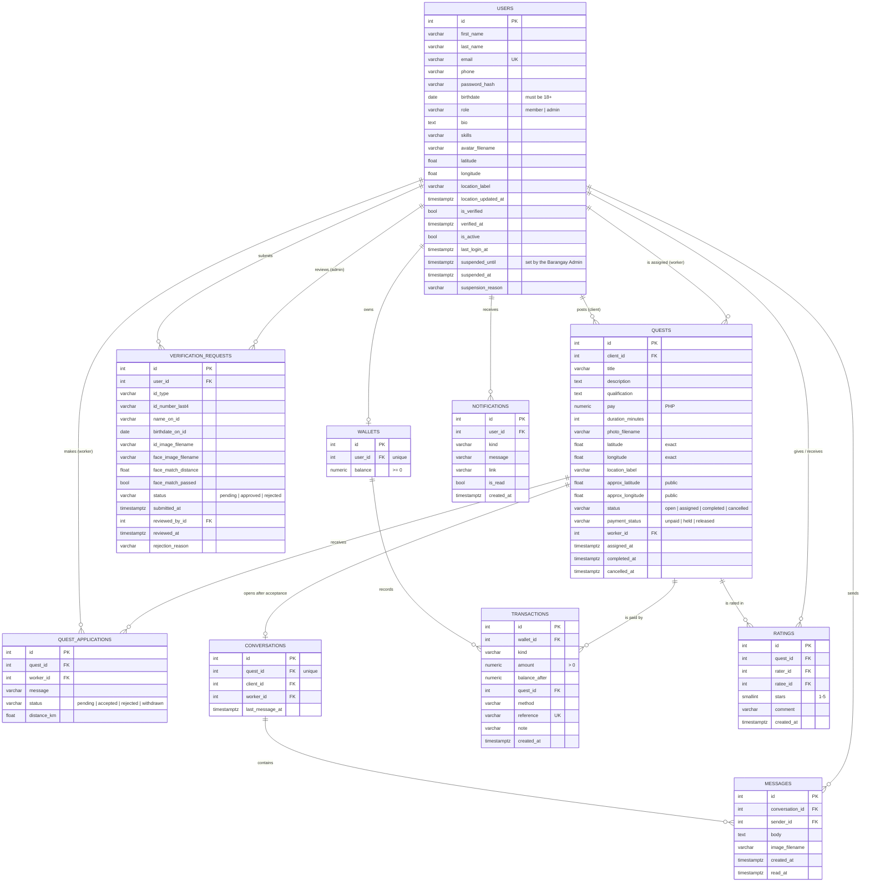

# QuestFinder — Database Schema (Deliverable 2)

PostgreSQL, normalized to 3NF. Managed by Flask-Migrate (Alembic); the initial migration is
`migrations/versions/0001_initial_schema.py`. Status-like columns are `VARCHAR` with `CHECK`
constraints instead of PostgreSQL `ENUM` types so they are easy to change in later migrations.
Money uses `NUMERIC(…, 2)` (never floats). All timestamps are `TIMESTAMPTZ` stored in UTC and shown
in Asia/Manila time.

## Entity-Relationship Diagram

> The diagram renders in VS Code with the *Markdown Preview Mermaid Support* extension
> (recommended in `.vscode/extensions.json`) and on GitHub.

## Tables

| Table | Purpose | Key rules enforced in the database |
|---|---|---|
| `users` | One account per person. Members act as **client** or **task worker**; `admin` = Barangay Admin. Holds the user's own location for distance matching. | Unique email; `role` in (member, admin); lat/lng ranges. 18+ is checked on registration and again by the admin against the ID. A suspended user (`suspended_until` in the future) cannot log in and their open quests are hidden. |
| `verification_requests` | ID scan + face scan submissions and the Barangay Admin's decision. | `status` check. Only the **last 4** characters of the ID number are stored. Images are kept outside the public static folder. |
| `quests` | Posted tasks: Location, Work Description, Qualification, Offered Pay, Photo (prototype fields) + Title and Duration (shown on the quest card and details screens). | `pay > 0`, `duration_minutes > 0`, `worker_id <> client_id` (**a client can never take their own quest**), status checks. Exact and approximate coordinates are stored separately. |
| `quest_applications` | A task worker tapping **ACCEPT QUEST**; the client then accepts one worker. | One application per worker per quest (unique); status check. |
| `wallets` | Simulated e-wallet, one per user. | `balance >= 0`. |
| `transactions` | Every peso movement: deposit, withdraw, quest_hold (pay reserved on acceptance), quest_earning (pay released on completion), quest_refund. Powers the **Transaction History** tab. | `amount > 0`, `kind` check, unique reference. Wallet rows are locked (`SELECT … FOR UPDATE`) during changes. |
| `conversations` | One chat per quest between the client and the accepted worker. | One per quest (unique); `client_id <> worker_id`. |
| `messages` | Text and image messages in a chat thread. | Must have text or an image. |
| `notifications` | Bell notifications (accepted quests, completion, verification result). | `kind` check. |
| `ratings` | Two-way ratings and reviews after completion. | 1–5 stars; one rating per person per quest; cannot rate yourself. |

## Normalization notes

* No repeating groups or multi-valued columns (1NF). Every non-key column depends on the whole key (2NF).
* No transitive dependencies (3NF): a user's average rating is **computed** from `ratings`, a wallet's
  history from `transactions`, and a quest's applicant count from `quest_applications`, so none is stored twice.
* `transactions.balance_after` is a deliberate audit snapshot (the balance right after that entry), not a
  derived value used for logic; the source of truth is `wallets.balance`.
* `users.is_verified` caches the outcome of the latest approved `verification_requests` row so every page
  does not need a join; it is only changed by the admin approval service.
